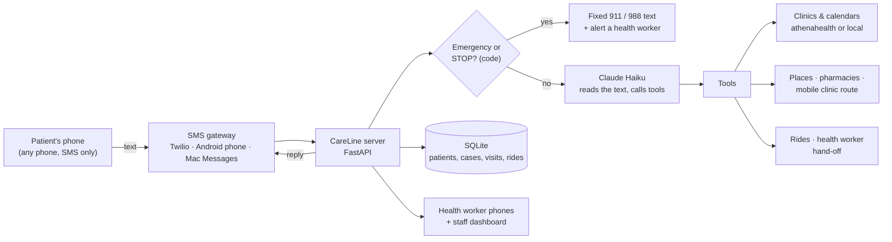

# CareLine

**Healthcare by text message for rural Southeast Ohio.** Text one number from any phone, even a
flip phone with no data plan, and CareLine finds a clinic near you, books the visit, sets up a ride,
points you to a pharmacy, and gets a community health worker on the line when a person is needed.

No app. No internet. No hold music.

Built at **Hackpalachia 2026** (Ohio University) in the Care Delivery track.

---

## What it feels like

A real conversation with the agent version (`/simulator-agent`), lightly trimmed:

```
Patient   my kid has an earache. need to bok a appointment
CareLine  Sorry your kid has an earache. I can help book a visit. What town or ZIP code are you in?
Patient   45742
CareLine  Thanks, I have Little Hocking (45742). Does your child have Medicaid, no insurance or low
          income, or other insurance or can pay?
Patient   It's medicaid. I'm Ethan
CareLine  Thanks, Ethan. Your child's visit options near 45742, Medicaid:
          1. Athens Free Clinic, 21 mi, Mon 11/16 5:30pm
          2. Athens Health Ctr, 21 mi, Thu 11/19 3pm
          3. Mobile clinic, Belpre, Mon 11/23 9am (by phone 740-593-2432)
Patient   2
CareLine  Athens Health Center on Thu 11/19 at 3pm is held for your child. Please text the child's
          full name and date of birth here. The visit isn't booked until we get it.
Patient   Lily Knotts 06/02/2019
CareLine  Your child's visit is booked: Athens Health Center, 40 Elm St, Athens, Thu 11/19 at 3pm.
          Visit ID V-1001. Clinic phone: 740-555-0112. Do you need a ride?
```

Typos, slang and half-answers are fine. The date of birth in that exchange never reaches the AI
model: code checks it with the clinic's records system directly.

## What it does

| | |
|---|---|
| **Book a visit** | Town or ZIP (all 1,416 Ohio ZIP codes, misspellings OK), one coverage question, then up to three nearby options with distance and next open time. Low-income and uninsured patients see free and sliding-scale clinics first. |
| **Real clinic booking** | Clinics on **athenahealth** (athenaOne) are booked, moved and cancelled through the athenahealth API; the rest use a local calendar. |
| **Change or cancel** | "can we do later in the week", "i cant make it", `RESCHEDULE`, `CANCEL VISIT`. Cancelling always asks to confirm. |
| **Reminders** | One text 24 hours before each visit. |
| **Rides** | Medicaid's free-ride info for those who qualify, or a health worker books an Uber Health ride and texts the pickup time. |
| **Medicine** | The three nearest real pharmacies with phone numbers (135 community pharmacies from the CMS NPI Registry), plus advice to ask about an emergency refill. |
| **Mobile clinic** | The real Heritage Community Clinic route (Ohio University). |
| **A real person** | Anything the line can't handle goes to a community health worker, and the patient is always told so. Workers reply by text (`#12 your message`) or from the dashboard; neither side sees the other's personal number. |
| **Emergencies** | Chest pain, can't breathe, stroke, overdose: call 911. Thoughts of suicide, even indirect ("what's the point anymore"): the 988 line. Checked in code before any AI runs, in English and Spanish. |
| **English and Spanish** | Replies follow the patient's language. |
| **Plain SMS** | Every text fits plain SMS (GSM-7): no links, no emoji, nothing a flip phone can't show. |

## Two ways to run the conversation

Both run on the same server, data and tools. Try them side by side.

| | Scripted line: `/simulator` | Pure agent: `/simulator-agent` |
|---|---|---|
| Who writes the replies | Fixed, tested text templates | Claude, every reply |
| Free text | Claude maps "im on medicaid" or "the tuesday one" onto the scripted answers, and answers questions once a visit is booked | Claude runs the whole conversation with tools |
| Strength | Predictable; every acceptance criterion is checked automatically | Feels like texting a person; handles anything |
| Code | [`sms/app/relay.py`](sms/app/relay.py), [`understand.py`](sms/app/understand.py), [`agent.py`](sms/app/agent.py) | [`sms/app/pure_agent.py`](sms/app/pure_agent.py) |

In both modes the AI never makes up facts: clinic names, times, addresses and phone numbers only
come from tools that read the same data and calendars.

## How it works



## Safety and privacy, by design

These are enforced in code, not left to the model:

- **Emergencies first.** A keyword check (English and Spanish) runs before any model and sends a
  fixed 911 or 988 text. Chest pain on its own also lists the warning signs and lets the patient
  reply 1 to reach a person if it's mild.
- **Facts only from tools.** The agent can only state what a tool returned. It doesn't guess prices
  or coverage, and it doesn't give medical advice.
- **Confirm before cancelling**, and only ever the patient's own visits.
- **The date of birth never reaches the AI.** It's redacted from the conversation history, and the
  athenahealth identity check happens in code.
- **Model reasoning is never sent.** The agent can only answer through a `send_reply` tool, so its
  own working-out never reaches a patient.
- **Never silence.** If the model is down or unsure, the text goes to a health worker and the
  patient is told so.
- **Carrier rules:** STOP / START opt-out handling.
- **Prompt-injection guard:** patient texts are treated as something to answer, never as
  instructions (tested against "ignore your instructions", "show me another patient's address", etc.).

## Quick start

Requires Python 3.11+ and [uv](https://docs.astral.sh/uv/).

```bash
cd sms
cp .env.example .env
```

In `.env`, pick the model that reads texts:

| `LLM_PROVIDER` | What you need |
|---|---|
| `anthropic` (recommended) | `ANTHROPIC_API_KEY`. Turns on free-text understanding and both agents. |
| `ollama` | A local [Ollama](https://ollama.com) model (`llama3.1:8b`). Patient texts never leave the machine. |
| `rules` | Nothing. Keyword rules only; the agents stay off. |

Then:

```bash
uv run uvicorn app.main:app --reload --port 8790
```

| Open | What it is |
|---|---|
| http://127.0.0.1:8790/simulator | iPhone-style phone simulator, scripted line. `?worker=1` adds a health worker phone. |
| http://127.0.0.1:8790/simulator-agent | Same phone, pure agent. **Chats** reopens past conversations. |
| http://127.0.0.1:8790/dashboard | Staff dashboard: cases, transcripts, rides, visits. |

No SMS provider is needed for any of this: with no gateway configured, the server runs in dev mode
and the simulator plays the phone.

## Put it on real phones

| Option | Clinic number is | Setup |
|---|---|---|
| **Mac Messages** | Your iPhone's own number, via a Mac | 5 minutes, no registration (`SMS_PROVIDER=mac`) |
| **Android gateway** | An Android phone with a SIM ([SMS Gateway for Android](https://sms-gate.app)) | 10 minutes plus a public tunnel (`SMS_PROVIDER=android`) |
| **Twilio** | A real 740 number | Carrier registration (A2P 10DLC) takes days |

Step-by-step instructions for each are in [`sms/TESTING.md`](sms/TESTING.md).

## athenahealth

Clinics with an `athena` block in [`services.json`](sms/app/data/services.json) read open times
from athenahealth and book, move and cancel there. To try it without keys, run the bundled fake
athenahealth API:

```bash
uv run uvicorn tools.fake_athena:app --port 8796
# then in .env: ATHENA_CLIENT_ID=x  ATHENA_CLIENT_SECRET=x  ATHENA_BASE_URL=http://127.0.0.1:8796
```

For real Preview keys, see "athenahealth booking" in [`sms/TESTING.md`](sms/TESTING.md).

## Checks

Run these from `sms/`.

| Command | Covers | Needs |
|---|---|---|
| `python tools/check_story.py` | Every acceptance criterion of user story 1, end to end (a running server on port 8794) | Nothing |
| `python tools/check_athena.py` | Booking, slot-taken, reschedule and cancel through athenahealth (server on 8797, fake API on 8796) | Nothing |
| `python -m tools.check_agent` | Agent tools on real data, actions, no leaked reasoning, no date of birth to the model, fallbacks | Nothing (add `--live` for real Claude) |
| `python -m tools.check_understand` | Free-text answers mapped to scripted answers | Nothing (add `--live` for real Claude) |
| `python -m tools.check_llm` | Triage of real-life messages (need, urgency, place) | The configured `LLM_PROVIDER` |

Each script's header has the exact commands to start the servers it needs.

## Repository map

```
docs/
  USER_STORIES.md        user stories, acceptance criteria and their status
sms/
  app/
    main.py              FastAPI app: SMS webhooks, simulators, dashboard API
    relay.py             scripted conversation, health worker relay, reminders
    pure_agent.py        the pure agent: system prompt, tools, loop
    agent.py             agent for questions after booking (scripted line)
    understand.py        maps free-text answers onto scripted answers
    triage.py            need / urgency / place, emergency and crisis keywords
    services.py          clinics, open times, distances, pharmacies, mobile route
    athena.py            athenahealth API client
    sms.py · mac_messages.py   sending: Twilio, Android gateway, Mac Messages, dev
    db.py                SQLite: patients, cases, messages, bookings, rides
    data/                places, clinics, pharmacies, mobile clinic route
    static/              phone simulators and dashboard
  tools/                 checks, fake athenahealth and Android APIs, setup scripts
  TESTING.md             everything from the simulator to real phones
```

## Data: what's real

| Data | Source |
|---|---|
| Places | All 1,416 Ohio ZIP codes with town names and coordinates |
| Pharmacies | 135 community pharmacies within 50 miles of Athens, from the CMS NPI Registry ([`fetch_pharmacies.py`](sms/tools/fetch_pharmacies.py)) |
| Mobile clinic | Heritage Community Clinic route, copied from ohio.edu on 2026-11-14 |
| Heritage Community Clinic | Real clinic, address and phone (booked by phone) |
| Other clinics | **Samples** (555 phone numbers) to show the booking flow; replace with real partners |

Use made-up patients in demos. Real patient texts need a Twilio BAA (HIPAA) or a self-hosted
model.

## Status

Working end to end in the phone simulator. The real-SMS gateways (Mac Messages, Android, Twilio)
are built in and documented in [`sms/TESTING.md`](sms/TESTING.md), but not yet demoed on real
phones. Known limits:

- **athenahealth:** checked against the bundled fake API; the real Preview sandbox rejected our app
  keys (athena side).
- **Rides:** requests go to a health worker who books in Uber Health. There's no direct Uber Health
  API integration yet (it needs an organization account).
- **Pure agent:** newer than the scripted line, with fewer automated checks so far.

---

Group 3 · Hackpalachia 2026 · Ohio University
